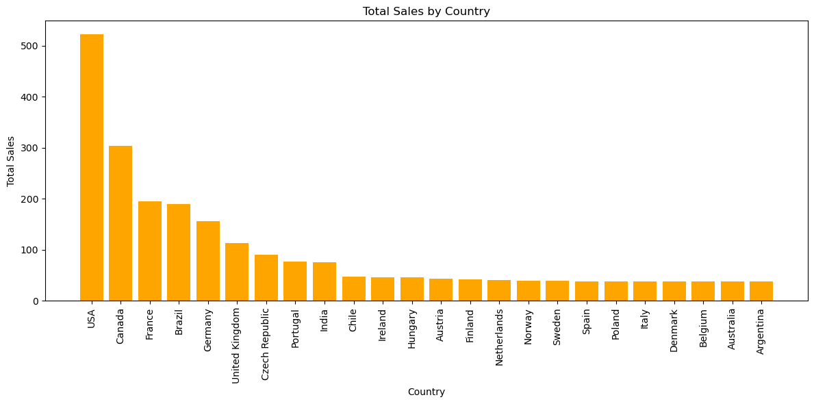
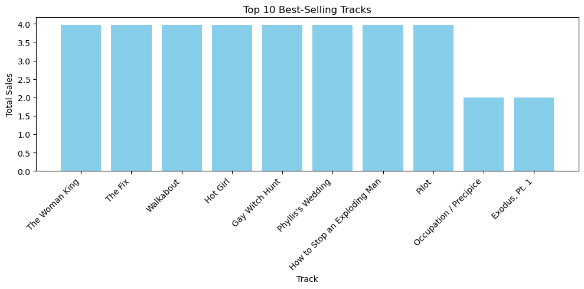
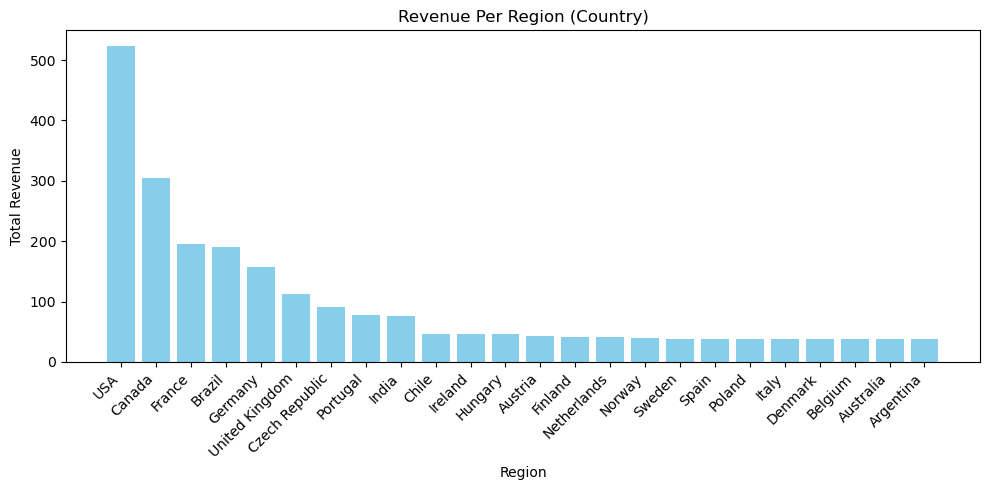
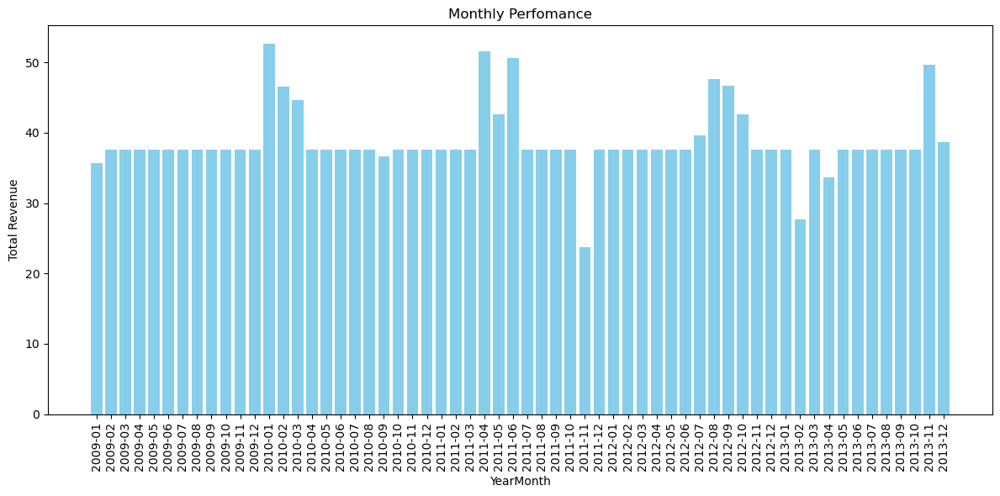

# SQL Product Sales Analysis

**Repository:** [github.com/nkongdem/Sql-Product-Sales-Analysis](https://github.com/nkongdem/Sql-Product-Sales-Analysis)

An in-depth SQL analysis of the Chinook digital music store database, turning relational sales data into revenue, product, and regional performance insights using joins, aggregations, and window functions.

## Overview

This project performs an in-depth SQL-based analysis of a product sales dataset using the Chinook relational database (Kaggle). The goal was to analyze transactional sales data stored across multiple related tables and extract meaningful business insights using structured SQL queries. By applying joins, aggregations, window functions, and business logic, the project demonstrates how raw relational data can be transformed into actionable insights for decision-making.

## Objectives

- Analyze product sales performance using SQL
- Identify top-selling tracks and products
- Calculate revenue per country and region
- Evaluate monthly sales performance trends
- Rank products using window functions
- Demonstrate practical use of JOINs, aggregations (SUM, COUNT, AVG), GROUP BY/HAVING, and window functions (RANK, ROW_NUMBER)

## Dataset

**Chinook Database** (Kaggle) — simulates a digital music store with related tables including Customers, Invoices, Invoice Items, Tracks, Albums, Artists, Genres, and Employees.

## Methodology

1. **Data Exploration** — load and review database schema, identify primary/foreign keys, understand table relationships
2. **JOIN Operations** — combine Invoice + Invoice_Items, Tracks + Albums + Artists, Customers + Invoices
3. **Aggregation & Business Metrics** — total revenue per product, revenue per country, monthly sales performance, purchases per customer
4. **Window Functions & Ranking** — applied `ROW_NUMBER()` and `RANK()` for ranked product lists

## Key findings

- Revenue is concentrated in a handful of top countries and top-selling tracks.
- Monthly performance shows clear trend patterns useful for forecasting and seasonal planning.
- Window-function rankings surface the top track per country/region, directly actionable for regional marketing.

These insights support inventory decisions, targeting high-value markets, focusing marketing on top performers, and strategic pricing.

## Contents

```
├── Product_sales _analysis using SQL.ipynb   # Full SQL analysis notebook
├── Chinook_Sqlite.sqlite                     # Source relational database
├── charts/                                   # Result chart images (shown above)
└── README.md
```

## Results

**Total sales by country**



**Top-selling tracks**



**Revenue by region**



**Monthly sales performance**



## Tools

- SQL (SQLite)
- Python — executing SQL queries
- Pandas, NumPy, Matplotlib — results handling and visualization

## Future improvements

- Build interactive dashboards (Power BI / Tableau)
- Automate reporting with Python
- Extend analysis with customer segmentation
- Implement advanced analytics using SQL + machine learning
- Optimize query performance for large-scale databases
